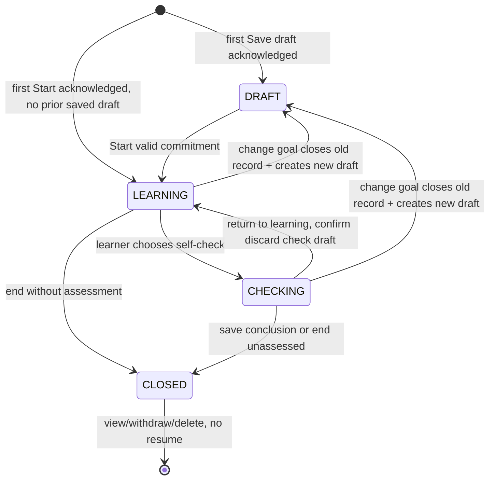

# 05 — Business rules and product data behavior

Version 0.2 · 22/11/2026 · **all BRs PROPOSED**. This defines observable semantics and concepts, not database schemas, APIs, classes or implementation algorithms.

## Concepts and relationships

One local dataset contains learning-session records. A record has an editable draft commitment; once started, its original goal/material/plan become the commitment for that session. An open record can contain a partial self-check draft. A closed record pairs its original commitment with a saved conclusion. A closed conclusion can have one withdrawal annotation. A subsequent session is always a distinct record; copying context never copies an assessment.

The goal describes a small action the learner will try and what they consider sufficient. Material locator is optional text such as a page/exercise reference. Planned comparison source is what they expected to use; actual comparison source is what they declare using. These are text references, not imported content or verified links. Attempt mode and outcome are self-reports. No record represents externally certified knowledge.

## BR-001 — One open record

At most one saved record in DRAFT, LEARNING or CHECKING exists in the current local dataset. CLOSED records do not occupy the slot. No account/cross-device coordination is promised. Opening setup while a record is open routes to that record, with options to continue or explicitly close/delete it; never silently replace it. Saving a draft is not starting learning. Repeated actions on the same record do not create a second record.

With no saved open record, New opens one **unsaved preparation form**, not a persisted empty DRAFT. This is an interaction state, not a fifth record phase; it does not create a saved slot/history item. Repeated New reuses that form without clearing it. Back before edits returns Home. After edits, **only when no save has been submitted/pending and no saved record exists**, Discard leaves no record/slot; Save creates one DRAFT and Keep editing stays in the form. Lack of acknowledgment alone does not prove no data was committed; pending/unknown actions follow BR-008 before discard/retry/new work. Process death can lose unsaved preparation. First successful Start may directly create one LEARNING record with commitment, without a separate Save draft. First-save/backup information is shown before either save action. A failed/lost-acknowledgment first save recovers no record or one complete intended record, never a ghost/duplicate.

For an already saved DRAFT, Discard only removes unsaved edits, retaining saved draft and occupied slot; removing that record is the separate confirmed Delete action. Explicit goal-change and optional past-context actions create a **saved** successor DRAFT as their acknowledged result, unlike New opening an unsaved form. Transient preparation cannot bypass the same UI single-work guard or be silently replaced by a second New/history action. If past-context creation is requested while an unsaved form contains edits, first resolve Save/Keep editing/Discard. Save occupies the slot and prevents another draft; Discard with known no committed record permits the new explicit action; Keep editing cancels it.

## BR-002 — Input contract

Proposed UX limits, not empirical performance targets: goal1–500 Unicode scalar values; material locator0–300; planned/actual comparison reference0–500; gap/next-step note0–1000; optional conclusion/withdrawal note0–500. Whitespace-only is empty; trim outer whitespace, preserve internal newlines and Unicode content without silent truncation. UI states the limit and identifies the field; test exact boundary and boundary+1 with simple text plus Vietnamese/combining-text preservation. Dev Studio may propose different limits by PCR, not silently truncate.

Drafts may be incomplete but must respect field type/length. Start requires a nonempty goal and an explicit comparison-plan choice: READY requires planned reference text; NOT_READY permits no reference and shows that assessment may be unavailable. Optional material locator does not block Start. Text presence is not proof that the goal is measurable, source adequate or material legally owned. No automatic semantic grading, URL fetching or source validity check.

## BR-003 — Commitment and time

Start freezes the original goal, optional material locator and planned comparison choice/reference. It records the start event; it does not establish sustained attention or time spent learning. Started/closed timestamps are device metadata, not a timer, source of learning truth or guaranteed accurate real time. Clock/timezone changes never change verdicts or auto-close a record. Display relevant time with context; history ordering uses recorded creation order, stable through corrections/clock changes, not a learning ranking.

Editing a learning goal after Start uses the explicit goal-change action: original record closes UNASSESSED with reason “Đổi mục tiêu”; one new DRAFT receives the original setup fields for editing, not attempt/actual-source/outcome/gap. The user reviews and starts the new goal separately. Original closure and new draft are one whole user-visible save, or neither happens. Canceling confirmation changes nothing. No in-session goal version engine.

## BR-004 — Lifecycle and navigation

The goal-change arrows cross **two records**, not reopening the old record. They implement BR-003's whole-action contract. Deleting any record removes it; it is not a learning-success transition. Leaving/locking/killing/rebooting the app does not change phase. No PAUSED/CANCELED state or automatic completion exists in this timer-free baseline. Phase denotes workflow position, not continuous concentration.

| From | Allowed action / target | Guard and data effect |
|---|---|---|
| DRAFT | save/edit DRAFT; Start→LEARNING; delete | BR-002 input rules; Start commits snapshot once |
| LEARNING | save/leave LEARNING; enter CHECKING; end→CLOSED; change goal | No minimum duration. End without assessment yields UNASSESSED |
| CHECKING | save/leave CHECKING; conclude→CLOSED; return→LEARNING; change goal | Conclude BR-005/006; return requires confirmation and clears check draft only after successful save |
| CLOSED | view; withdraw conclusion; delete; optionally create new DRAFT | Never Resume or edit commitment. Withdrawal is BR-007, optional new draft requires free slot |

Screen Back is navigation only. With unsaved edits, offer Save and leave / Keep editing / Discard unsaved edits. Saving partial form does not conclude. Returning to learning from CHECKING is an explicit distinct action, warns about discarding **both saved and unsaved self-check draft content** and preserves original commitment. Goal change gives the same explicit check-draft discard warning. Cancel preserves both saved and in-memory content; success clears the old check draft, not the original commitment. Any unlisted phase transition is rejected without changing the last saved state.

## BR-005 — Eligibility and honest result vocabulary

Attempt mode applies to the particular attempt being reported: INDEPENDENT (“Tôi tự thử, không dùng lời giải/gợi ý để làm lần thử này”), ASSISTED (“Tôi dùng lời giải/gợi ý/trợ giúp trước hoặc trong lần thử để giải câu đó”), NOT_CONFIRMED (“Chưa tự thử hoặc chưa chắc”). Viewing an answer **after committing the attempt, solely to compare it**, is comparison, not assisted solving. No mode preselected. Prior studying is not automatically assistance during this attempt, and a familiar question does not establish transfer to unseen questions. These are declarations, not anti-cheat evidence.

Comparison status is one explicit choice: NOT_CONFIRMED (“Chưa đối chiếu hoặc chưa chắc”), DONE_INSUFFICIENT (“Đã đối chiếu nhưng chưa đủ cơ sở tự kết luận”), DONE_SUFFICIENT (“Đã đối chiếu và có đủ cơ sở tự kết luận theo mục tiêu”). No status preselected. Only INDEPENDENT + DONE_SUFFICIENT + nonempty actual comparison reference enables one of MEETS / PARTIAL / NOT_YET. Mere source text or a completed comparison with inadequate basis never enables an assessed verdict. It is always displayed as **“Tự đánh giá sau đối chiếu: …”**, with attempt mode visible. It never means app-certified mastery. Actual reference may differ from the original plan; retain/display both without editing the original commitment.

ASSISTED, NOT_CONFIRMED, missing/inadequate comparison source, uncertainty or a learner choosing not to conclude can close UNASSESSED. Assistance can still yield a useful gap; it does not yield a verdict about independent performance in this proposed contract. The generic label is “Chưa có kết luận về tự làm”; when ASSISTED and comparison is DONE_INSUFFICIENT or DONE_SUFFICIENT, show “Chưa xác nhận tự làm — đã đối chiếu có trợ giúp”, also retaining whether the comparison basis was insufficient. Never label that case simply “chưa tự kiểm”, which would deny the comparison that occurred. With comparison NOT_CONFIRMED/unset, indicate comparison not established. No forced repeat, excuse or failure label. A source declaration cannot turn uncertainty into a pass. If changed inputs make a selected assessed verdict ineligible, clear that selection, keep notes, explain the guard; do not silently choose another verdict.

## BR-006 — Conclusion validation

MEETS: eligible self-assessment, optional note. PARTIAL/NOT_YET: eligibility plus gap/next-step text **or explicit “Chưa xác định được”**, not a fabricated explanation. The unknown-gap choice and nonempty gap text are mutually exclusive; switching away from entered text requires clear discard confirmation. No app-generated diagnosis or scheduling obligation.

UNASSESSED: no assessed verdict, gap/note optional; retain a supplied attempt mode/actual source as self-report. Closing directly from LEARNING does not invent a mode/comparison. A system reason may describe goal change or missing confirmation, never learning ability. Closed means the record was saved and the slot freed, not that learning was successful. Close requires an explicit user action and a whole saved conclusion.

## BR-007 — Correction without rewriting learning history

Original CLOSED commitment and conclusion are immutable. To correct an entered **assessed** conclusion (MEETS/PARTIAL/NOT_YET, not already withdrawn), user can add a **withdrawal annotation** with optional note; it prominently marks the original as “Kết luận đã được bạn rút lại”. The original remains visible only as original self-report, not as a currently valid assessment in any list, detail or copied context. No new verdict is added, original start/close times are unchanged; withdrawal has its own timestamp. A repeated request yields the same withdrawal, not duplicate annotations. Withdrawal cannot be undone or used to upgrade an unassessed/assisted result; deleting or starting a new session is available. Unassessed records have no assessment to withdraw; mistaken notes can be deleted with the record or contextualized in a new session. This deliberately small correction path is PROPOSED; replacement-result correction remains a documented alternative in the decision register.

Readable history includes assessed, unassessed and withdrawn records with explicit status. A new draft from past content never reuses attempts/verdicts or edits the old record. No achievement score, completion percentage or mastery dashboard derives from records.

## BR-008 — Save, failure, duplicate and interruption semantics

Explicit Save draft, Save for later and state-changing actions are durable save boundaries. New alone is not such a boundary; first Save or Start creates the persisted record per BR-001. “Đã lưu trên thiết bị” appears only when the entire associated state/data is saved. No every-keystroke autosave promise. Unsaved edits may be lost when the process/device dies; acknowledged saves must survive ordinary restart. If failure happens around a save, recovery shows either the full prior state (including no record before first save) or full new state, never half a conclusion/goal split/deletion. Retrying the same action does not duplicate records, closures or withdrawal.

Distinguish a **known uncommitted failure** (“Chưa lưu”) from a **pending/unknown outcome** (“Chưa xác nhận được kết quả lưu”). Keep current input while process lives, no false success or app-controlled loss. While a result is pending/unknown, do not accept a destructive Discard/Delete/New or rollback promise on the assumption nothing was saved. Offer status check/retry of reconciliation, or let the user leave/kill the app knowing the result will be resolved on return. First read actual durable state: if full save exists, show that record/phase (Discard afterward only drops newer unsaved edits); if known uncommitted, retry the deliberate action or discard is safe; if unreadable, use data-error flow rather than assume empty. This is an interaction save-status condition, not an extra learning phase.

On restart reconcile from actual durable state rather than replaying a queued UI button blindly. Retrying a lost-acknowledgment command cannot create a duplicate; cancellation before submission is a no-op but cancellation after commit cannot undo it. The mechanism belongs to Dev Studio. Concurrent double taps or stale screens cannot overwrite a newer saved/closed/deleted state; show actual current state and permit a fresh deliberate action.

## BR-009 — Self-check drafts and dependencies

Partial CHECKING data is distinct from a CLOSED conclusion. Save for later accepts incomplete final fields while honoring type/length and no invalid final verdict. No saved check draft is shown as a completed assessment. Raw exercise/answer/photo, camera/mic, web imports and answer storage are outside baseline. User compares material outside the app and supplies references, not copyrighted content by requirement. No mandatory app permission or network is needed.

## BR-010 — Retention, backup and recovery limits

Records are retained until user deletion, without silent age expiry or background uploads by Fokus. No account, Fokus cloud sync/backup, analytics upload or recovery service. **PROPOSED policy:** OS backup/transfer may include app data when the OS/user enables it; no guaranteed restore, exact freshness or deletion of historic OS copies. This must be disclosed before the first save and in data information. “Local” does not mean never leaves the device under OS backup.

After an OS restore, operate on the actual recovered dataset: no merging with another device, no guarantee of identifying that a restore occurred, no auto-completion or fabricated missing edits. Old active phase remains an open record. Deleted data **or a previously withdrawn conclusion** can reappear in a pre-deletion/pre-withdrawal OS snapshot; the app cannot promise latest-state recovery or erase every backup. A restored stale snapshot is not falsely presented as synchronized/latest. Uninstall/data-clear/offload/restore behavior must be verified on the eventual support matrix. No backup configuration algorithm or architecture is prescribed.

Unreadable data is an error, not an empty history or permission to overwrite. Offer retry and a clearly separate destructive reset with confirmation only if user chooses to abandon the current dataset; no automatic reset. Preserve recoverable data where feasible, but never claim an invented recovery. Product does not promise salvage after corruption/device loss.

## BR-011 — Deletion and scope

Delete one record requires confirmation naming the record and the current-dataset scope; deleting the open record also clears the open slot. Delete all learning data requires separate explicit confirmation and clears draft/open/history/withdrawal annotations together. Cancel is a no-op. A successful deletion is no longer visible or used by any app view; retry cannot delete another record. Failed deletion reports failure and leaves the actual data state truthful. No recycle bin/undo in MVP; no “erased everywhere” wording. OS copies are outside this command's scope, as BR-010 discloses.
